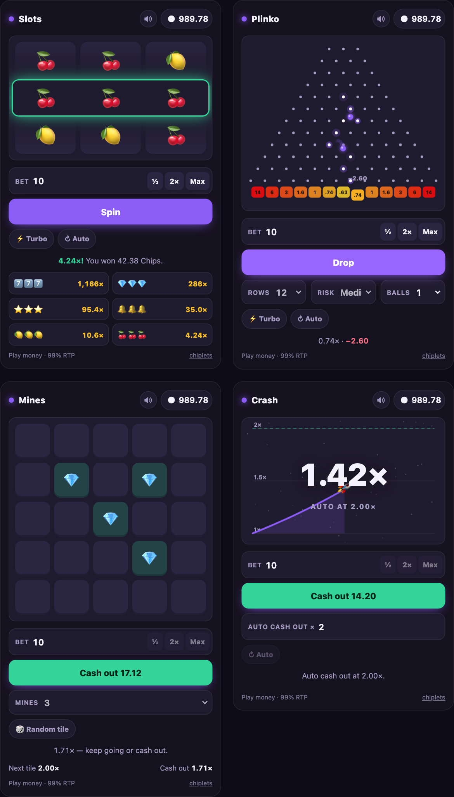

# Chiplets

Play-money casino games for any website. Slots, Plinko, Mines and Crash as drop-in web components: one script
tag, no sign-in, no server, no real money.

```html
<script src="https://chiplets.dev/v1/chiplets.js" defer></script>

<chip-slots></chip-slots>
<chip-plinko rows="12" risk="medium"></chip-plinko>
<chip-mines mines="3"></chip-mines>
<chip-crash auto="2"></chip-crash>
```

- **Try it and build a snippet:** [chiplets.dev/playground](https://chiplets.dev/playground)
- **Full docs** (attributes, events, theming, JavaScript API): [chiplets.dev/docs](https://chiplets.dev/docs)
- **See the same components carry a whole site:** [chiplets.win](https://chiplets.win)



## What you get

- **Four games, one wallet.** Every game on a page shares one play-money balance, kept in the visitor's browser.
- **Small.** The core is about 14 KB compressed and each game 3–5 KB, loaded only when a page uses its tag. All
  four in one file is about 25 KB. No dependencies, no build step, no audio or image files.
- **Themeable.** An accent colour, light or dark, your own currency name and icon, your own slot symbols, and CSS
  custom properties (`--chip-accent`, `--chip-bg`, …) for the rest.
- **Finished.** Sound made in the browser, phone vibration, big-win celebrations, autoplay with stop rules, turbo,
  keyboard controls, screen-reader labels, and reduced motion respected.
- **Honest.** Published odds, proven by the tests in this repository. Effects follow results that are already
  decided: no fake near-misses.

Works with plain HTML and with anything that renders custom elements (React, Vue, Astro, WordPress's Custom HTML
block). Browsers: Chrome and Edge 100+, Firefox 100+, Safari 16+.

## Play money only

Chiplets has no way to buy currency, cash out or win prizes, and that is deliberate. Balances live in the
visitor's browser, so anyone can edit theirs with developer tools: don't attach anything of value to them. If you
connect these games to real money or prizes, gambling laws apply to you, and this project can't help you with
that. The games are casino-style and meant for adult audiences.

## Three ways to load it

| | Use it when |
|---|---|
| `https://chiplets.dev/v1/chiplets.js` | You want fixes automatically. Nothing within v1 will break your page. |
| `https://chiplets.dev/v1.3.3/chiplets.js` | You want one exact version. Released files never change. |
| Your own server, or `npm install chiplets` | You'd rather not depend on chiplets.dev at all. |

Self-hosting: run `npm run build` and serve the `dist/` folder; keep `games/` next to `chiplets.js`, or serve only
`chiplets.all.js`. With a bundler, `import 'chiplets'` registers all four elements.

## Check what you embed

A script on your page can do anything your page can, so you shouldn't have to take this one on trust.

**Pin it with an integrity hash.** Use a pinned all-in-one file, so the hash covers every game (the on-demand
loader in `chiplets.js` adds each game's file without a hash):

```html
<script src="https://chiplets.dev/v1.3.3/chiplets.all.js"
        integrity="sha384-xSW//2msZ7bDGlORWmpEzQQp/h6QFOD8Lc5jbqt5OnLjaxafZkkQ7HJL0+cvGNCm"
        crossorigin="anonymous" defer></script>
```

[`integrity.json`](integrity.json) lists the hash of every file of every released version.

**Rebuild it yourself.** The build is reproducible:

```sh
npm install
npm run verify     # builds dist/ and checks every file against integrity.json
```

Then compare with what the server really sends:

```sh
curl -s https://chiplets.dev/v1.3.3/chiplets.all.js | openssl dgst -sha384 -binary | openssl base64 -A
```

**What the script does.**

- Network: it requests its own game files from wherever the core script was loaded, and nothing else. No
  analytics, no beacons, no fonts. (Image URLs you pass as symbols or icons are loaded as images.)
- Storage: `localStorage` keys starting with `chiplets:` (the wallet, sound and turbo settings, a Mines round in
  progress). No cookies.
- Page: it defines the `chip-*` elements, sets `window.Chiplets`, fires `chiplets:*` events, and adds one small
  style element that reserves each game's height while it loads. Everything else stays inside shadow roots.
- Randomness: `crypto.getRandomValues`.

**Content Security Policy.** Allow the script's origin in `script-src`. No `unsafe-eval` and no inline scripts are
needed. Tested in Chromium under `script-src 'self'; style-src 'self'`: the games load, are styled and play. That
policy does block the loading placeholder and a few inline `style` attributes (some option boxes lose their even
widths) and the console reports it; add `'unsafe-inline'` to `style-src` to avoid that. Removing the last inline
styles is planned.

## The odds

Every game is tuned to return 99% of what's bet over the long run.

| Game | How it works | Return |
|---|---|---|
| Slots | Three reels of 64 weighted stops; three of a kind on the middle line pays. | 99.00% |
| Plinko | Even odds at every peg, so buckets follow a binomial curve; multipliers are rounded to readable numbers. | 98.56–99.00%, by board |
| Mines | The payout after k safe tiles is 0.99 ÷ the chance of surviving k picks. | 99% at any cash-out |
| Crash | The chance of reaching x is 0.99 ÷ x, up to 1,000×. | 99% at any target |

`test/math.test.mjs` proves these from the same tables the games use, and `Chiplets.odds.plinko(rows, risk)`
returns a board's exact figure. One caveat: payouts are rounded down to 0.01 of a chip, so bets far below 1 chip
return noticeably less. A minimum bet that removes this is planned.

## Events and API, briefly

```js
document.addEventListener('chiplets:win', (e) => {
  // e.detail = { game, bet, payout, profit, multiplier, balance, currency, ... }
});

Chiplets.wallet.balance      // current balance
Chiplets.wallet.give(500)    // reward a visitor
Chiplets.wallet.take(50)     // spend on something of yours; false if they can't afford it
Chiplets.config({ currency: 'Tokens', icon: '🪙' })
```

The rest is in the [docs](https://chiplets.dev/docs).

**Rounds decided on a server (experimental).** Games ask an *engine* for every outcome and only animate its
answer. The built-in engine runs in the browser; `Chiplets.connect(engine)` swaps in your own, which is how
chiplets.win decides signed-in players' rounds on its server using the same rules as `src/rules/`. The interface
is in `src/core/engine.js`. It isn't documented or stable yet; if you need it, open an issue and say what for.

## Working on it

```sh
npm install
npm test          # the odds and the round rules
npm run demo      # builds, then serves a demo page at http://localhost:8080/
```

- `src/math/` — each game's odds, as pure functions
- `src/rules/` — round logic shared by the browser and a server
- `src/core/` — wallet, engine, base element, sound, effects, the on-demand loader
- `src/games/` — the four elements

This repository is published from a private one that also holds the chiplets.dev and chiplets.win websites, so
its history is one commit per release. Issues and pull requests are welcome here; accepted changes are applied
upstream and arrive with the next release.

"Plinko" is used in its everyday, generic sense; Chiplets is not affiliated with any television show or casino.

## Licence

[MIT](LICENSE)
